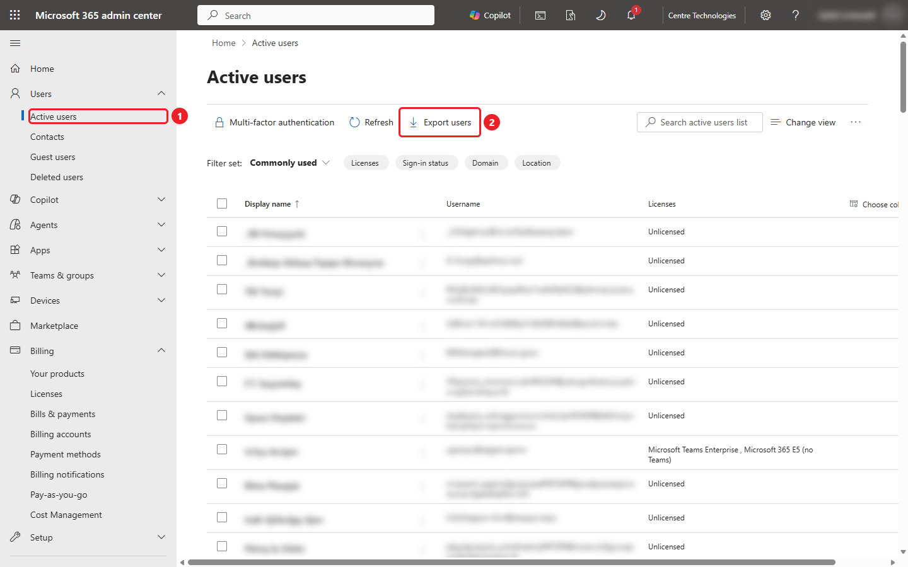
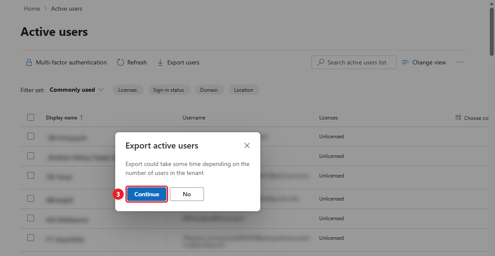
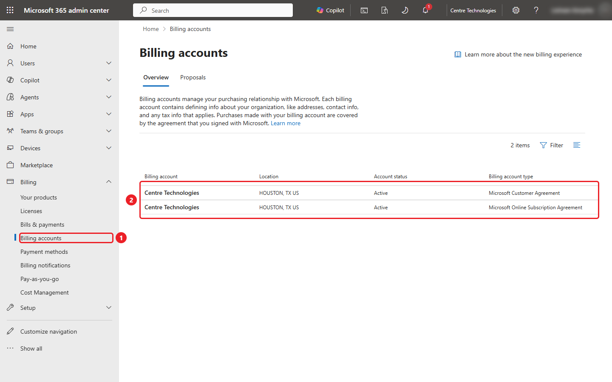
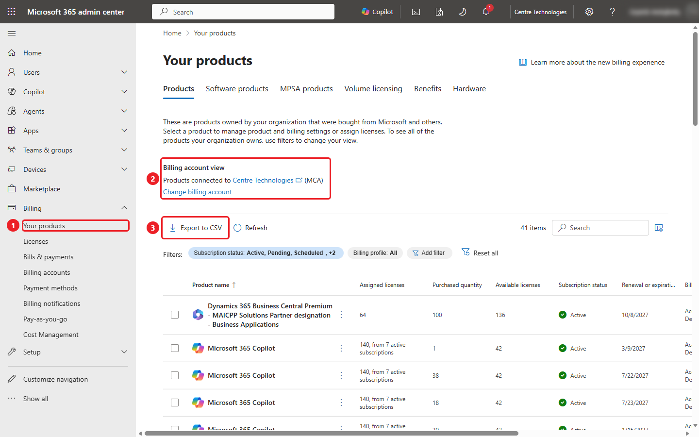
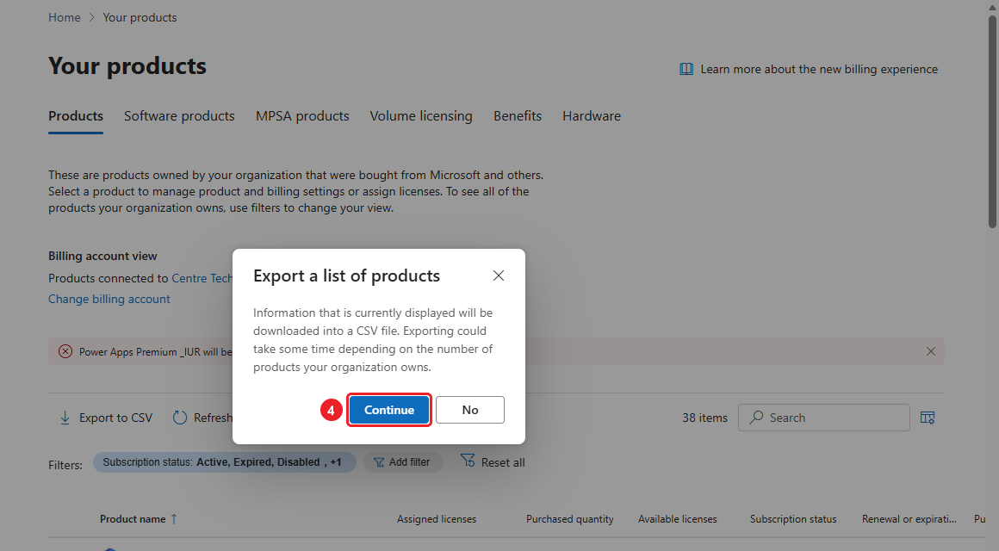
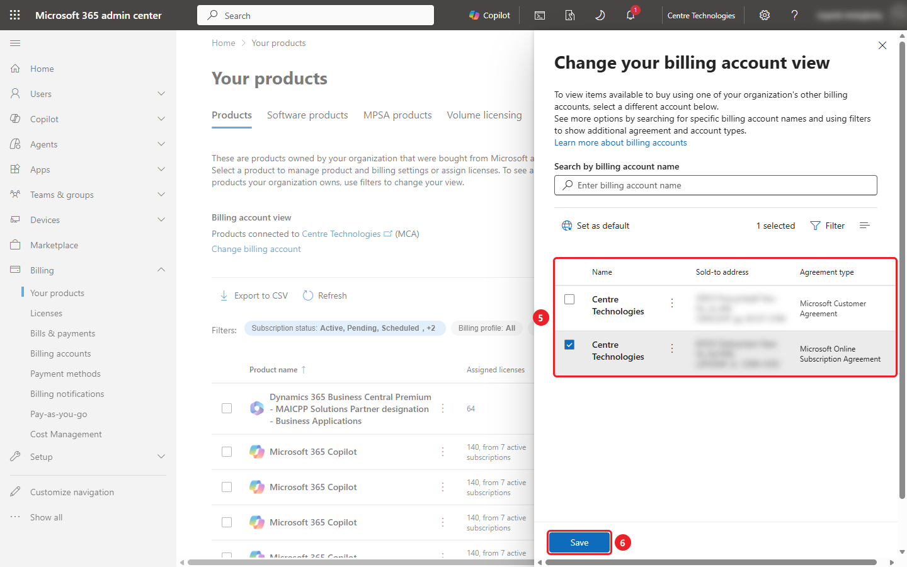
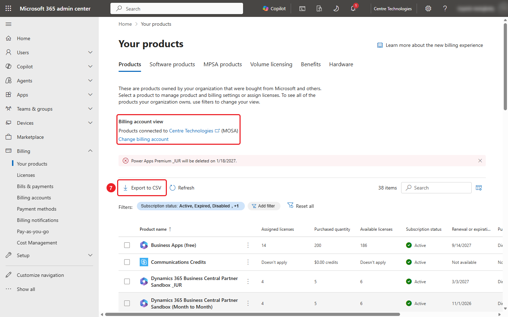
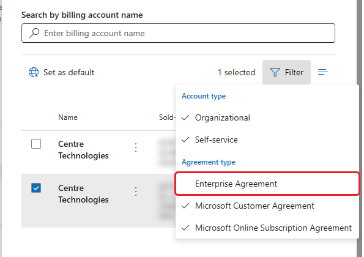

# M365 Assessment: Easy Mode

Can't run the assessment script? You can still give us what we need for a
license review by exporting two lists from the Microsoft 365 admin center.
It takes about 10 minutes and nothing needs to be installed.

A Word version of this guide is in
[`M365-Assessment-Easy-Mode.docx`](M365-Assessment-Easy-Mode.docx).

## What you'll send us

| File | Where it comes from | How many |
| --- | --- | --- |
| `users_<date> <time>.csv` | **Users > Active users > Export users** | One |
| `Products_<date-time>.csv` | **Billing > Your products > Export to CSV** | One for **each** billing account |

## Before you start

- Sign in to the [Microsoft 365 admin center](https://admin.microsoft.com)
  with an account that has **Global Reader** or **Global Administrator**.
  A billing role (Billing Administrator or Billing Reader) can also see the
  billing pages.
- If the left menu looks short, select **Show all** at the bottom of it.
- Use a computer, not a phone. Files go to your browser's normal
  **Downloads** folder.
- The red numbered markers on each screenshot show what to click, in order.

## Part 1: Export the user list

1. In the left menu, select **Users > Active users** (1).
2. Clear the search box and leave the filter set on **Commonly used** so
   everyone is included.
3. Select **Export users** (2).

   

4. In the **Export active users** box, select **Continue** (3).

   

5. Your browser downloads a file named like
   `users_10_22_2026 3_02_16 PM.csv`. In large tenants this can take a
   minute or two, so keep the page open until it appears.

## Part 2: Count your billing accounts

Microsoft shows products one billing account at a time, so you need to
know how many you have before exporting them.

1. In the left menu, select **Billing > Billing accounts** (1).
2. Count the rows (2) and note the **Billing account type** of each one.
   Common types are Microsoft Customer Agreement (MCA), Microsoft Online
   Subscription Agreement (MOSA), Enterprise Agreement (EA) and Microsoft
   Partner Agreement (licenses bought through a partner).

   

If there is only one row, you'll do one product export in Part 3. If there
are two or more, you'll do one export per row.

## Part 3: Export products per billing account

1. In the left menu, select **Billing > Your products** (1).
2. Look at **Billing account view** (2). It tells you which billing account
   is on screen, for example **(MCA)**.
3. Leave the filters as they are. The defaults include active, expired and
   disabled subscriptions, which is what we want.
4. Select **Export to CSV** (3).

   

5. In the **Export a list of products** box, select **Continue** (4). Your
   browser downloads a file named like `Products_2026-10-22T10_01_21-05_00.csv`.

   

### Repeat for each additional billing account

6. Select **Change billing account** under **Billing account view**.
7. In the panel, select the next billing account in the list (5), then
   select **Save** (6). Don't select **Set as default**.

   

8. **Billing account view** now shows the account you picked, for example
   **(MOSA)**. Select **Export to CSV** (7), then **Continue**.

   

9. Repeat steps 6 to 8 until you have one `Products_*.csv` file for every
   billing account you counted in Part 2.

> **Tip: Enterprise Agreement accounts are hidden by default.** If Part 2
> showed an Enterprise Agreement, or you know you have one, select
> **Filter** in the **Change your billing account view** panel and tick
> **Enterprise Agreement** so it appears in the list.
>
> 

> **Tip:** Reloading the page switches the view back to your default billing
> account. Check the **Billing account view** line before each export.

## Part 4: Send the files to Centre

You should now have:

- [ ] One `users_*.csv` file
- [ ] One `Products_*.csv` file per billing account

Send them to your Centre contact using the secure file share link they
provided. The user list contains names, email addresses and phone numbers,
so please don't post it anywhere public.

## Troubleshooting

| What you see | What to do |
| --- | --- |
| **Export users** or the **Billing** menu is missing | Your account doesn't have a high enough role. Ask a Global Administrator to run the export or assign you Global Reader. |
| **Billing accounts** says *You have no billing accounts* | Your role can't read billing. Global Reader, Billing Reader or Billing Administrator is needed. |
| No **Change billing account** link | You only have one billing account. One product export is enough. |
| Nothing downloads after **Continue** | Wait a minute, then check your **Downloads** folder and your browser's download bar for a blocked download. |

The screenshots in this guide come from a real tenant with names,
usernames, addresses and the signed-in user blurred.
